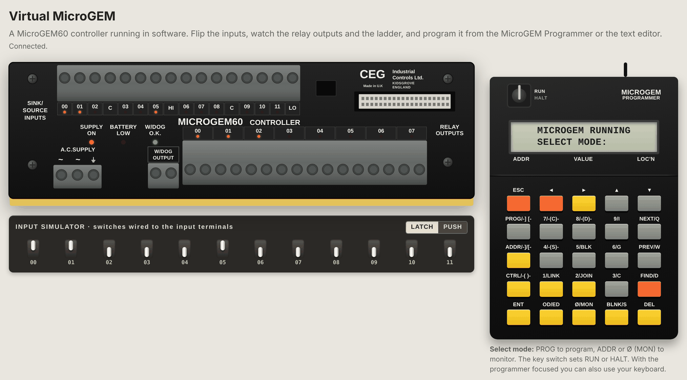
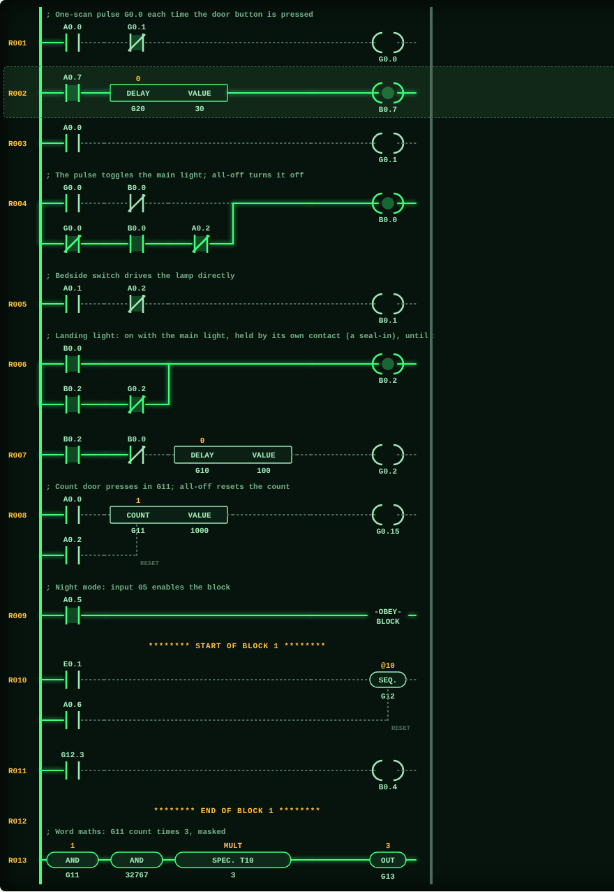

# Virtual MicroGEM

[](https://hacs.xyz)
[](https://github.com/Vortitron/MicroGem/releases)
[](https://github.com/Vortitron/MicroGem/actions/workflows/validate.yml)
[](https://github.com/Vortitron/MicroGem/actions/workflows/tests.yml)

A software emulation of the GEC **MicroGEM** programmable controller, with the
bigger **GEM 80** as the longer-term goal. It runs a ladder program against
GEM 80 style data tables and shows a front panel whose input and output lights
change live. In Home Assistant the virtual controller's relays can switch real
lights, and its inputs can be wired to real sensors.



## Install in Home Assistant

Needs Home Assistant 2025.1 or later.

### With HACS

[](https://my.home-assistant.io/redirect/hacs_repository/?owner=Vortitron&repository=MicroGem&category=integration)

Or by hand: open HACS (the **Marketplace** from Home Assistant 2026.11) >
three-dot menu > **Custom repositories**, add
`https://github.com/Vortitron/MicroGem` as type **Integration**, download
**Virtual MicroGEM** and restart Home Assistant.

### Without HACS

Download `microgem.zip` from the [latest release](https://github.com/Vortitron/MicroGem/releases/latest),
unzip it into `config/custom_components/microgem/` and restart Home Assistant.

## Set up

[](https://my.home-assistant.io/redirect/config_flow_start/?domain=microgem)

Add **Virtual MicroGEM** under Settings > Devices & services, choose a name and
how many expansion units it has (0 to 7; you can change this later under
**Configure**). You can add more than one controller. You get:

- a switch for each input (`switch.<name>_input_a0_0` ...): automations can
  "press" the controller's inputs,
- a binary sensor for each output (`binary_sensor.<name>_output_b0_0` ...):
  use these in automations to switch real lights,
- a **Run** switch (off = HALT, all outputs off),
- a **Watchdog** binary sensor, the W/DOG OUTPUT contacts: on after three
  clean scans in Run, off in Halt, and off with a trip when the program holds a
  non-zero code in `F1` for 100 ms (GEM80-400 manual T1614, 2.12; its
  `trip_code` attribute holds the code). Use it to interlock anything the
  controller drives,
- the front panel and program editor in the sidebar (admins only), with links
  to all of these entities,
- a `microgem.load_program` action.

The program and Run/Halt state survive restarts.

### Field wiring

You can also wire terminals straight to Home Assistant entities, as you would
cable a real controller, with no automations. Click an input terminal or a
relay output on the controller drawing in the panel and pick an entity. The
picker searches names and ids as you type (`*` matches anything, so
`kitchen*light` finds "Kitchen ceiling light"), and buttons narrow it to
switches, lights, sensors, helpers and so on. It starts on switches.

- an **input** follows the entity's state: the contact is closed while it is
  on, open, home, playing and so on, and open while it is off, closed, away,
  unavailable and so on. You can read one of its attributes instead, and give a
  threshold so the contact closes while a number is above it (a temperature,
  say). **Invert** makes it a normally closed contact, closed while the entity
  is off. A missing or unavailable entity always leaves the contact open. A
  wired input's simulator switch is greyed out;
- a **relay output** switches the entity on and off with the relay
  (`homeassistant.turn_on` / `turn_off`, so lights, switches, fans, helpers,
  covers and so on). Buttons are pressed, and scenes, scripts and automations
  run, each time the relay closes. A newly wired entity is put in step with its
  relay at once; after that it changes only when the relay does.

The controller's own input switches and output sensors are its internal I/O,
so they are left out of the list and cannot be wired to a terminal.

The cables and the entity names are drawn on the controller (click a name to change it), and listed under
**Field wiring** in the panel. The wiring is kept in the config entry's
options and changes take effect at once.

To remove it, delete the controller under Settings > Devices & services, then
remove **Virtual MicroGEM** in HACS and restart.

## The front panel

The same panel runs in the Home Assistant sidebar and as a standalone web page.
It shows:

- the **MicroGEM60 controller**, drawn from a photo of the real unit: 12
  sink/source inputs (00 to 11, words A0.0 to A0.11), 8 relay outputs (B0.0 to
  B0.7), a red LED under each terminal number, and the SUPPLY ON, BATTERY LOW
  and W/DOG O.K. lamps;
- any **expansion units** on its expansion port (`--expansions`, 0 to 7). The
  original MicroGEM took one (40 I/O); the MicroGEM60 takes up to 160 I/O,
  which matches seven units of 12 inputs and 8 outputs. Unit *n* uses word *n*
  of the A and B tables, so terminal 03 on expansion unit 1 is `A1.3`. The
  expansion units' size and addressing are our best guess: no MicroGEM manual
  has turned up yet, and T1282 describes the GEM 80's 9007/9008 remote I/O
  units, not MicroGEM expansions;
- an **input simulator** board of toggle switches (latching or push-button);
- the **MicroGEM Programmer**, with its key switch (RUN/HALT), 2×16 display and
  all 25 keys. `CTRL` gives a key its second legend.
  - *MON* (`Ø`): `ADDR`, a table key (`I` = A inputs, `Q` = B outputs, `G`,
    `W`, `C`, `D`, `S`) and a word or bit (`►` types the dot), `ENT` to watch
    it live; then a number and `ENT` to force it. `NEXT`/`PREV` step.
  - *PROG*: the display is a 2 × 16 window onto the ladder, drawn as in the
    GEM 80 manual (T391): symbols on the top line (`+--] [-----]/[-----( )--+`),
    addresses underneath, branches hanging from `+` and `!`, live wires as
    dashes and dead ones as dots. The element under the cursor blinks. `◄►`
    move along a branch, `▲▼` between branches and on to the next rung, and
    `NEXT`/`PREV` jump a rung. `BLNK` starts a new rung,
    `ED` re-keys the selected one, `DEL` then `ENT` deletes it, `FIND` jumps to
    an address. Inside a rung the keys give their symbols: contacts `-] [-` and
    `-]/[-`, `-(D)-` (DELAY word and VALUE in 0.1 s) and `-(C)-` (COUNT word and
    VALUE), which sit in the rung as on the GEM 80. `▼` opens a parallel
    branch (or starts the next line down) and `JOIN` closes it; `LINK` is only
    a spacer, as in the manual. End the rung with `-( )-` (coil), `-(S)-`
    (sequencer) or `BLK` (OBEY BLOCK, or END OF BLOCK on an empty rung). `ENT`
    writes the rung, `DEL` undoes the last step.
  - With the programmer focused, the computer keyboard works too.
- **demo programmes** to load from a picker above the program text: bedroom
  lighting, a pelican crossing (SEQR), a star-delta starter, a duty/standby
  pumping station and a bottle packing conveyor. Each one's first comment
  lines say which inputs and outputs do what;
- a live **ladder diagram** drawn like the GEM 80 programmer screen: live
  paths solid, dead paths dotted, with the time left above each DELAY, the
  count above each COUNT, and values above OUT and word elements;
- the full **program text** editor, and a data-table monitor.



## Run it without Home Assistant

```sh
pip install -e .
python -m microgem            # then open http://127.0.0.1:8080
python -m microgem --program my_program.txt --port 8080
python -m microgem --expansions 2   # add two expansion units
```

## How it works

| Layer | File | Job |
|---|---|---|
| Data tables | `microgem/tables.py` | Lettered tables of 16-bit words, addressed like `A0.3` or `G12` |
| Program | `microgem/program.py` | Parses one-rung-per-line ladder text |
| Controller | `microgem/engine.py` | Scan cycle, 16-bit rung words, DELAY, COUNT, SEQR, OBEY BLOCK, Halt/Run behaviour |
| Service | `microgem/service.py` | Runs the scan every 20 ms and tells listeners about changes |
| Web | `microgem/server.py`, `microgem/web/` | Standalone page over a WebSocket |

The engine has no I/O of its own, so the same code will run inside Home
Assistant.

### Data tables

As on a GEM 80: `A` inputs, `B` outputs, `G H L N O U` workspace, `R W`
retained workspace, `E` flags, `F` faults, `P` presets, `C D J K I` remote and
serial I/O. Most tables are cleared on the Halt to Run transition; `A`, `P`,
`R` and `W` are kept.

### Program notation

Elements and behaviour follow the GEM 80 *Ladder Diagram Programming Manual*
(T391, issue 4). A 16-bit word flows along each rung: the left rail gives -1
(@FFFF), a contact passes the word on or gives 0, and the rung is ON when its
word is not 0. One line is one rung; `->` comes before its single output
element.

```
; comment lines above a rung become its title
A0.0 AND NOT A0.1 -> B0.0                 ; contacts in series, then a COIL
(A0.2 OR B0.1) AND NOT A0.3 -> B0.1       ; parallel branches (wired OR); also a seal-in latch
A0.4 DELAY G10 VALUE 25 -> B0.2           ; on-delay 2.5 s; G10 counts down the 0.1 s steps left
A0.5 COUNT G11 VALUE 10 RESET A0.6 -> B0.3 ; counts OFF-to-ON changes; bit 15 of G11 is the last input
B0.0 INV DELAY G12 VALUE 50 INV -> B0.4   ; INV, DELAY, INV: an off-delay
E0.1 -> SEQR G13 RESET A0.7               ; one bit walks left each scan the rung is on
AND G1 ADD 5 -> OUT G2                    ; plant G1 on the rung, add 5, write the word
A1.0 AND @00FF -> OUT G3                  ; 16-bit logic: AND OR XOR INV
AND G1 MULT 3 -> OUT G4                   ; MULT and DIV are Special Functions T10 and T11
AND G1 ADD [AND G5] -> OUT G6             ; [ ] is a second branch into ADD (JOIN)
A1.1 -> BLOCK                             ; OBEY BLOCK: rungs down to END BLOCK run only
A1.2 -> B0.5                              ;   while A1.1 is on, and freeze while it is off
END BLOCK
```

ADD and SUB limit their result to ±32,767 and set `E0.7` (cleared by the next
ADD or SUB that does not overflow). Read-only flags follow the GEM80-400 manual
(T1614): `E0.0` pulses for one scan every 0.1 s, `E0.1` every second, `E0.6`
after a program change; `E1`-`E6` hold seconds, minutes, hours, day, month,
year; `E7` the previous scan time in ms. Hex numbers are written `@00FF`.

Extensions that are not in a real GEM 80, kept for convenience and marked
"ext" on the ladder: `RISE A0.0` / `FALL A0.0` one-scan pulses, word
comparisons such as `G1 GE 5` (the real controller uses Special Functions),
and `SET` / `RESET` outputs (the real one latches with a seal-in branch).

## Not known yet

- The MicroGEM's own details. T391 covers the GEM 80; the MicroGEM programmer
  photo shows I and Q table keys (mapped here to the A and B tables), and
  `-(S)-` is taken to be SEQR. Which GEM 80 elements the MicroGEM lacked (it
  has no keys for AND, ADD or OUT) is not known, so the text editor accepts
  them all.
- The default 12 inputs / 8 outputs match the MicroGEM60; `--inputs` /
  `--outputs` change them.

## Development

```sh
pip install -e '.[test]'
pytest                                   # engine and standalone panel

pip install pytest-homeassistant-custom-component home-assistant-frontend
pytest -c tests_ha/pytest.ini --rootdir=. tests_ha   # Home Assistant integration
```

HACS installs only `custom_components/microgem`, so the integration carries a
copy of the engine in `custom_components/microgem/core`. After changing
anything in `microgem/`, run `python scripts/sync_ha_core.py` (a test checks
they match). [RELEASING.md](RELEASING.md) explains how to cut a release.

## Disclaimer

This is an independent hobby project. It is not made, endorsed or supported by
GEC, GEC Industrial Controls, Cegelec, Alstom, Converteam, GE or any of their
successors. The names GEC, GEM 80 and MicroGEM are used only to say which
hardware is being emulated. The controller drawing carries a made-up badge,
CEG Industrial Controls, and Home Assistant lists the devices as made by the
equally made-up Harecastle Controls; neither is the GEC mark. Do not use it
to control anything where a fault could hurt someone.

## Licence

[MIT](LICENSE)
